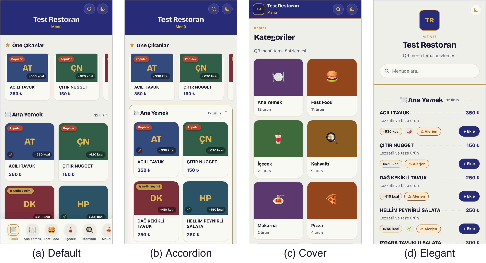

# QR Menü Temaları

Masadaki QR kodu okutan misafirin telefonunda açılan dijital menü için dört görsel
stil. Salihli Belediyesi Bilgi İşlem Müdürlüğü'ndeki stajımda, belediyenin sosyal
tesisleri ve kafe/restoranlar için hazırladım. Her tema bir mekânın markasına
uyarlanabilecek şekilde tasarlandı.



## Temalar

| Klasör | Stil |
|--------|------|
| `themes/modern` | Varsayılan tema. Öne çıkan ürünler, kategori sekmeleri ve ürün kartları |
| `themes/accordion` | Kategoriler açılıp kapanır; uzun bir menüde aranan bölüme hızlı gidilir |
| `themes/cover` | Kapak görseli ve kategori kartlarıyla açılır |
| `themes/elegant` | Daha sade ve resmi, liste düzeninde bir görünüm |

Dört temada da ürün arama, ürün detayı, alerjen ve kalori bilgisi, sipariş listesi
ve açık/koyu görünüm var.

## Tasarım ilkeleri

- **Yemek önde.** Ürün adı, fiyat ve açıklama en görünür öğe; arayüz süsü geride kalır.
- **Önce telefon.** Düzen mobil için kuruldu; ucuz telefonlarda ve yavaş bağlantıda
  da hızlı açılması hedeflendi.
- **Erişilebilirlik.** Hedef WCAG 2.1 AA: gövde metninde en az 4.5:1 kontrast,
  en az 44 px dokunma alanı, `prefers-reduced-motion` desteği ve Türkçe karakterlerin
  (İ, ı, Ş, Ğ, Ç, Ö, Ü) her yerde doğru görünmesi.

Ayrıntılar: [docs/PRODUCT.md](docs/PRODUCT.md)

## Çalıştırma

Kurulum ya da derleme gerekmiyor. Bir temanın `index.html` dosyasını tarayıcıda
açman yeterli:

```bash
open themes/modern/index.html
```

Yazı tipi Google Fonts'tan yüklenir; internet yoksa sistem yazı tipine geri döner.

## Menü verisi

Her temanın menü içeriği `js/data.js` dosyasında `QRM.data.menu` nesnesi olarak
durur. Depodaki veriler örnektir ("Test Restoran", 65 ürün).

```js
QRM.data = { menu: {
  restaurantName: "Test Restoran",
  currency: "₺",
  categories: [
    { name: "Ana Yemek", items: [
      { name: "ACILI TAVUK", price: 350.0, calories: 530,
        allergens: [], diet: ["Acı"], highlight: "Popüler" }
    ]}
  ]
}};
```

Kendi menünü göstermek için bu dosyadaki kategorileri ve ürünleri değiştirmen yeterli.

## Klasör yapısı

```
qr-menu-themes/
├── themes/
│   ├── modern/      index.html · css/ · js/app.js · js/data.js
│   ├── accordion/
│   ├── cover/
│   └── elegant/
└── docs/
    ├── PRODUCT.md   tasarım kararları ve hedef kullanıcılar
    └── screenshots/
```
